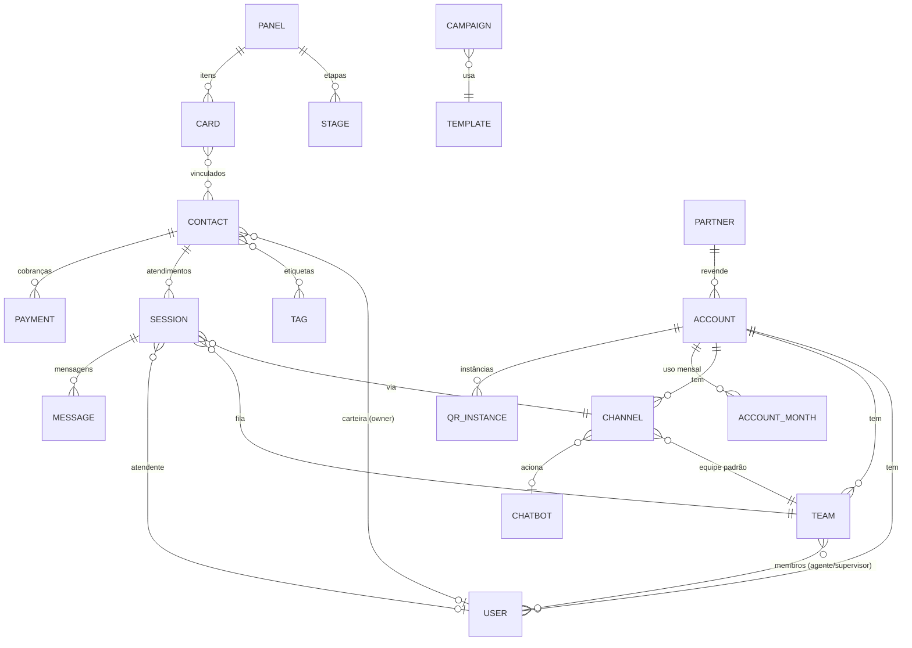

# Modelagem do sistema — Elena Atendimento

Documento gerado a partir da navegação no sistema de referência (plataforma de atendimento via WhatsApp que o parceiro usa hoje). Mapeia telas, entidades, regras de negócio e a regra de faturamento white label, que foi deduzida e conferida contra os valores reais do relatório de abr/2026.

## 1. Mapa de telas

| Menu | Tela | Rota no Elena | Principais elementos |
|---|---|---|---|
| **Atendimentos** | Inbox | `/atendimentos/:id?` | Abas **Novos** (fila sem atendente), **Meus**, **Outros** (de outros atendentes, só supervisor/admin), **Grupos** e **Concluídos**; filtro Todas / Não lidas; busca; filtros por equipe, canal, etiqueta e atendente; ordenação; iniciar conversa por telefone (+55) |
| | Conversa | idem | Cabeçalho com contato, etiquetas, protocolo, acompanhar (olho), histórico, atendente, canal, status, **ligar** (WhatsApp/VoIP), **Transferir**, **Concluir** + preferências; mensagens com eventos de sistema (chatbot, distribuição, expiração, transferência, conclusão); composer com respostas rápidas (`/`), anexos, emojis, nota interna e áudio; janela de 24h do WhatsApp oficial |
| | Painel do contato | idem | Dados, etiquetas, **carteirização**, sequências, notas internas, campos personalizados; abas Histórico, Arquivos, Atendimentos, CRM e Pagamentos; bloquear, agendar e editar |
| | Chat interno | trilho direito | Canal "Todos" (com aviso fixado) + uma sala por equipe |
| **CRM** | Contatos | `/crm/contatos` | Tabela, busca, arquivados/bloqueados, importar/exportar, novo |
| | Painéis | `/crm/paineis` | Funis de Vendas/Gestão + "Minhas tarefas" por usuário; fixar; excluídos |
| | Kanban | `/crm/paineis/:id` | Colunas por etapa (contagem e soma), arrastar e soltar, Kanban/Lista, card com vencimento, responsável, etiquetas, contatos, valor, anotações, histórico e "mover de fase" |
| | Carteiras | `/crm/carteiras` | Contatos por vendedor responsável e transferência de carteira |
| | Dashboard | `/crm/dashboard` | Funil, valor por vendedor, conversão e vencimentos (no sistema de referência é um Looker Studio externo) |
| **Apps** | Campanhas | `/apps/campanhas` | Disparo em massa com modelo aprovado e funil enviado → entregue → lido → respondido |
| | Pagamentos | `/apps/pagamentos` | Cobranças Pix/boleto/cartão (Asaas) |
| | Chatbot | `/apps/chatbots` | Bots de atendimento (por canal) e de automação; fluxo |
| | Sequências | `/apps/sequencias` | Mensagens em etapas com atraso |
| | Mensagens agendadas | `/apps/agendadas` | Envio programado |
| | Meus apps | `/apps/meus-apps` | Marketplace de integrações |
| **Relatórios** | Indicadores | `/relatorios/indicadores` | Abas Geral/Usuário/Resultados; pendentes antes, novos, concluídos, pendentes após; capacidade, tempo de espera, duração, canais, etiquetas, mapa de calor |
| | Atendimentos | `/relatorios/atendimentos` | Lista com tempos, classificação e CSAT |
| | Consumo de infraestrutura | `/relatorios/infraestrutura` | Armazenamento, mensagens, IA, transcrição |
| **Ajustes** | Usuários, Equipes, Modelos de mensagens, Conta, Consumo de mensagens, Integrações | `/ajustes/*` | Equipe: padrão, acesso, canais, link direto, **distribuição**, **transbordo**, membros e papéis |
| **Admin** (parceiro) | Contas, Planos, Canais, Usuários ADM, Configurações da plataforma, Ações e menus, Avisos, Auditoria, **Relatório de faturamento**, Custo de infraestrutura, Consumo de mensagens, Relatório de conexões, Portal de parceiros | `/admin/*` | White label |

## 2. Entidades

Definidas em `src/types.ts` e espelhadas em `docs/schema.sql`.

**Atendimento (Session):** `status` = `new` (na fila da equipe, sem atendente), `open` (em andamento), `concluded`. Guarda `lastInboundAt` (janela de 24h), `firstResponseAt` (tempo de espera), `classification`, `saleValue` e `csat`.

**Mensagem:** `dir` = `in` | `out` | `bot` | `event` | `note`; `type` = `text` | `image` | `audio` | `document` | `location` | `template`. Eventos de sistema (distribuído, expirado, transferido, concluído, reaberto) também são mensagens, o que mantém a linha do tempo na própria conversa.

## 3. Regras de negócio do atendimento

1. **Entrada:** o cliente escreve num canal → o chatbot do canal mostra o menu → a opção escolhida direciona para uma **equipe** (evento "Chatbot direcionou…").
2. **Distribuição automática** (round-robin entre atendentes online, respeitando o limite de atendimentos simultâneos). Se o atendente não iniciar no prazo (`acceptTimeoutMin`), o atendimento **expira e é redistribuído**. Com **transbordo**, ele vai para o próximo atendente.
3. **Visibilidade:** acesso "Atendente" = só o atendente e os supervisores da equipe veem (abas Outros/Concluídos); acesso "Equipe" = todos os membros.
4. **Transferência** para equipe (redistribui) ou para usuário, com mensagem opcional. Equipes restritas mostram cadeado.
5. **Conclusão:** classificação opcional (alimenta relatórios e segmentação de campanhas) e CSAT opcional. Preferência: **arquivar em 12h** (nova mensagem reabre com o mesmo atendente) ou **arquivar imediatamente** (nova mensagem cria outro atendimento na fila).
6. **WhatsApp oficial:** fora da janela de 24h desde a última mensagem do cliente, só é possível enviar **modelo aprovado**.
7. **Carteirização:** contato com vendedor responsável, base para direcionar atendimentos ao dono da carteira.

## 4. Faturamento white label (motor em `src/lib/pricing.ts`)

Regra deduzida do relatório "Faturamento Parceiros" e **conferida conta a conta** com abr/2026:

| Item | Valor | Observação |
|---|---|---|
| Plano base por conta | R$ 149,90 | inclui 3 usuários e 1 canal |
| Usuário faixa 1 (4º ao 20º) | R$ 19,90 | |
| Usuário faixa 2 (21º ao 50º) | R$ 14,90 | |
| Usuário faixa 3 (51º+) | R$ 9,90 | *estimado; não havia caso real* |
| Canal faixa 1 (2º ao 5º) | R$ 29,90 | |
| Canal faixa 2 (6º+) | R$ 19,90 | |
| Chatbot com IA | R$ 50,00 | proporcional aos dias |
| Transcrição / ligações | uso | sem pró-rata |
| Instância QR (Z-API) | R$ 69,90/mês = R$ 2,33/dia | por dia de uso; < 24h não cobra |
| Licenciamento mínimo do parceiro | R$ 659,80/mês | proporcional no 1º mês (nov/25: 12 dias = R$ 263,92 ✔) |

- **Pró-rata:** conta que entra ou sai no meio do mês paga dias ÷ 30 (ex.: início 18/04 → 13/30). Quando a conta é **encerrada** no meio do mês, o dia seguinte ao fim também é cobrado (fim 13/04 → 14/30, conforme a referência).
- **Conta do parceiro:** isenta de plano base e de usuários (paga só canais extras).
- **Consolidado:** contas (ou o mínimo) + instâncias Z-API + infraestrutura + aplicativo + domínio − desconto por volume.

Conferências: 4 usuários e 2 canais = 149,90 + 19,90 + 29,90 = **199,70** ✔; 8 usuários e 5 canais = 149,90 + 5×19,90 + 4×29,90 = **369,00** ✔; 24 usuários e 2 canais = 149,90 + 17×19,90 + 4×14,90 + 29,90 = **577,70** ✔; 28 usuários, 10 canais e transcrição de 111,72 = **938,22** ✔.

## 5. Melhorias já incluídas no Elena (em relação à referência)

- Faturamento com KPIs, **evolução mensal**, **memória de cálculo por conta**, exportação CSV e aviso de mês parcial.
- **Simulador de preço** e tabela de preços editável (Admin → Planos).
- Fila com **alerta de SLA** (cliente esperando há mais de 10 min) e botão "Atender o próximo da fila".
- Dashboard de CRM nativo (a referência usa Looker Studio externo).
- Rateio do custo de infraestrutura e **margem por conta**.
- Mapa de calor de volume por dia × hora para dimensionar a escala.

## 6. Próximos passos sugeridos

1. Backend real (sugestão: Supabase/Postgres usando `docs/schema.sql`) + autenticação por OTP.
2. Integração com WhatsApp Cloud API (oficial) e com o provedor de QR (Z-API ou similar) via webhooks.
3. Editor visual de fluxos de chatbot.
4. Motor de distribuição no servidor (fila, timeout e transbordo).
